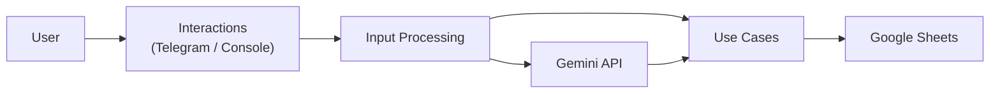

# MyFinanceTracker

[]()

Personal finance tracker that stores transactions in Google Sheets and supports multimodal expense tracking (text, voice, receipt photos, and banking screenshots) through Telegram and Console interfaces.

## Features

- Multimodal transaction input: text commands, voice messages, receipt photos, and banking screenshots
- Gemini-powered natural language processing, audio transcription, and image analysis
- Google Sheets persistence with automated category mapping
- Telegram Bot & Console interaction modes
- YAML-based category and alias configuration
- Clean Architecture + CQRS (MediatR)
- Structured logging with correlation IDs

## Architecture



## Project Structure

```text
src/
├── MyFinanceTracker.Domain/
├── MyFinanceTracker.Common/
├── MyFinanceTracker.UseCases/
├── MyFinanceTracker.Infrastructure.Persistence.GoogleSheets/
├── MyFinanceTracker.Infrastructure.Persistence.Yaml/
├── MyFinanceTracker.InputProcessing/
├── MyFinanceTracker.InputProcessing.Text.Gemini/
├── MyFinanceTracker.InputProcessing.Text.Structured/
├── MyFinanceTracker.Interactions.Console/
├── MyFinanceTracker.Interactions.Telegram/
└── MyFinanceTracker.Host/

tests/
├── MyFinanceTracker.Domain.Tests/
├── MyFinanceTracker.Infrastructure.Persistence.GoogleSheets.Tests/
├── MyFinanceTracker.Infrastructure.Persistence.Yaml.Tests/
├── MyFinanceTracker.InputProcessing.Text.Gemini.Tests/
└── MyFinanceTracker.InputProcessing.Text.Structured.Tests/
```

## Quick Start

### 1. Create your Google Sheets tracker

Create your own spreadsheet from the template:

https://docs.google.com/spreadsheets/d/19c9D0FdtEJCOoXVpclh6MyWBv0ZN7SgH5nojOpvZq9c/copy

### 2. Create a Google Service Account

1. Create a Google Cloud project.
2. Enable the Google Sheets API.
3. Create a Service Account.
4. Download the credentials JSON file.

### 3. Share the spreadsheet

Share your copied spreadsheet with the Service Account email address and grant it **Editor** permissions.

### 4. Configure categories

Copy the template:

```bash
cp deploy/categories.template.yaml categories.yaml
```

Adjust category names, aliases and spreadsheet column IDs as needed.

### 5. Configure the application

Create `appsettings.Local.json`:

```json
{
  "GoogleSheets": {
    "SpreadsheetId": "YOUR_SPREADSHEET_ID"
  },
  "Gemini": {
    "ApiKey": "YOUR_GEMINI_API_KEY"
  }
}
```

### 6. Run the application

```bash
git clone https://github.com/Linnod/MyFinanceTracker.git
cd MyFinanceTracker

dotnet build
dotnet run --project src/MyFinanceTracker.Host
```

## Configuration

### Full Configuration Example

```json
{
  "GoogleSheets": {
    "SpreadsheetId": "YOUR_SPREADSHEET_ID",
    "CredentialsFilePath": "google-api-credentials.json",
    "HeaderRowsCount": 3,
    "ApplicationName": "MyFinanceTracker",
    "DecimalSeparator": ","
  },
  "YamlPersistence": {
    "FilePath": "categories.yaml"
  },
  "Telegram": {
    "Token": "YOUR_TELEGRAM_BOT_TOKEN",
    "AllowedUserId": 123456789
  },
  "Interactions": {
    "EnableConsole": true,
    "EnableTelegram": false
  },
  "Gemini": {
    "ApiKey": "YOUR_GEMINI_API_KEY",
    "Model": "YOUR_GEMINI_MODEL"
  }
}
```

### Category Configuration Notes

> **Important**
>
> Category IDs must match the column IDs used by the Google Sheets template.
> Transactions are written to spreadsheet columns based on the category `id`.

> **Important**
>
> At least one income category must contain the alias `income`.
> This alias is used as the default income category by the application.

### Telegram Mode

```json
{
  "Interactions": {
    "EnableConsole": false,
    "EnableTelegram": true
  }
}
```

Make sure that:

- `Telegram:Token` is configured.
- `Telegram:AllowedUserId` contains your Telegram user ID.

### Console Mode

```json
{
  "Interactions": {
    "EnableConsole": true,
    "EnableTelegram": false
  }
}
```

## Usage Examples

### Text Commands (Console & Telegram)

Natural language input in English, Russian, or other languages:

```text
Spent 15.50 on groceries
Spent 8.40 at Starbucks yesterday
Received salary 2500
Clear expenses for groceries today
```

### Voice Messages (Telegram)

Send voice messages directly to the Telegram bot:

> *"Spent 12 euros on lunch at Subway"*  
> *"Купил кофе и круассан за 7.50"*

### Receipts & Screenshots (Telegram)

Send images directly to the bot:

- **Receipts**: Automatically extracts the total amount, infers the category from the merchant/items, and extracts the transaction date.
- **Banking App Screenshots**: Recognizes transaction details from apps such as Revolut, Monzo, etc.
- **Optional Captions**: Attach a text caption to clarify or override details (e.g. `Pharmacy yesterday` or `Groceries split with friend`).
