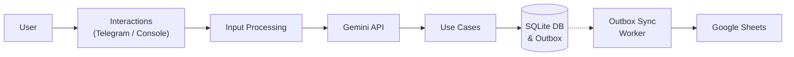

# MyFinanceTracker

[](https://github.com/Linnod/MyFinanceTracker/actions/workflows/ci-cd.yml)
[]()

Personal finance tracker that stores transactions in Google Sheets and supports multimodal expense tracking (text, voice, receipt photos, and banking screenshots) through Telegram and Console interfaces.

## Features

- Multimodal transaction input: text commands, voice messages, receipt photos, and banking screenshots
- Gemini-powered natural language processing, audio transcription, and image analysis
- Local SQLite persistence with Transactional Outbox pattern
- Resilient background synchronization to Google Sheets (retry policy & dead-letter queue)
- Automated category mapping with YAML configuration
- Telegram Bot & Console interaction modes
- Clean Architecture + CQRS (MediatR)
- Structured logging with correlation IDs

## Architecture



## Project Structure

```text
src/
├── MyFinanceTracker.Domain/
├── MyFinanceTracker.Common/
├── MyFinanceTracker.UseCases/
├── MyFinanceTracker.Infrastructure.Persistence.GoogleSheets/
├── MyFinanceTracker.Infrastructure.Persistence.Sqlite/
├── MyFinanceTracker.Infrastructure.Persistence.Yaml/
├── MyFinanceTracker.InputProcessing/
├── MyFinanceTracker.InputProcessing.Gemini/
├── MyFinanceTracker.Interactions.Console/
├── MyFinanceTracker.Interactions.Telegram/
└── MyFinanceTracker.Host/

tests/
├── MyFinanceTracker.Domain.Tests/
├── MyFinanceTracker.UseCases.Tests/
├── MyFinanceTracker.Infrastructure.Persistence.GoogleSheets.Tests/
├── MyFinanceTracker.Infrastructure.Persistence.Sqlite.Tests/
├── MyFinanceTracker.Infrastructure.Persistence.Yaml.Tests/
├── MyFinanceTracker.InputProcessing.Gemini.Tests/
└── MyFinanceTracker.Interactions.Telegram.Tests/
```

## Quick Start

### 1. Clone the repository

```bash
git clone https://github.com/Linnod/MyFinanceTracker.git
cd MyFinanceTracker
```

### 2. Create your Google Sheets tracker

Create your own spreadsheet from the template:

https://docs.google.com/spreadsheets/d/19c9D0FdtEJCOoXVpclh6MyWBv0ZN7SgH5nojOpvZq9c/copy

The spreadsheet uses a flat `Transactions` table schema with columns: `Id`, `Date`, `Type`, `Category`, `Amount`, `Note`.

### 3. Create a Google Service Account

1. Create a Google Cloud project.
2. Enable the Google Sheets API.
3. Create a Service Account.
4. Download the credentials JSON file and save it as `google-api-credentials.json` in the repository root.

### 4. Share the spreadsheet

Share your copied spreadsheet with the Service Account email address and grant it **Editor** permissions.

### 5. Configure categories

Copy the example template:

```bash
cp deploy/categories.example.yaml categories.yaml
```

Adjust category IDs, names, and aliases as needed.

### 6. Configure the application

Create `appsettings.Development.json` in the repository root:

```json
{
  "GoogleSheets": {
    "SpreadsheetId": "YOUR_SPREADSHEET_ID"
  },
  "Gemini": {
    "ApiKey": "YOUR_GEMINI_API_KEY",
    "Model": "YOUR_GEMINI_MODEL"
  }
}
```

### 7. Run the application

```bash
dotnet build
dotnet run --project src/MyFinanceTracker.Host
```

## Configuration

### Full Configuration Example

```json
{
  "GoogleSheets": {
    "SpreadsheetId": "YOUR_SPREADSHEET_ID",
    "CredentialsFilePath": "google-api-credentials.json",
    "TransactionsSheetName": "Transactions",
    "ApplicationName": "MyFinanceTracker",
    "DecimalSeparator": ","
  },
  "SqlitePersistence": {
    "ConnectionString": "Data Source=finance.db",
    "SyncIntervalSeconds": 60,
    "MaxRetryAttempts": 5
  },
  "YamlPersistence": {
    "FilePath": "categories.yaml"
  },
  "Telegram": {
    "Token": "YOUR_TELEGRAM_BOT_TOKEN",
    "AllowedUserId": 123456789
  },
  "Interactions": {
    "EnableConsole": true,
    "EnableTelegram": false
  },
  "Gemini": {
    "ApiKey": "YOUR_GEMINI_API_KEY",
    "Model": "YOUR_GEMINI_MODEL"
  }
}
```

### Category Configuration Notes

> [!IMPORTANT]
> Category `id` is a unique identifier (slug), and `name` is used as the category name recorded on the `Transactions` sheet.

### Telegram Mode

```json
{
  "Interactions": {
    "EnableConsole": false,
    "EnableTelegram": true
  }
}
```

Make sure that:

- `Telegram:Token` is configured.
- `Telegram:AllowedUserId` contains your Telegram user ID.

### Console Mode

```json
{
  "Interactions": {
    "EnableConsole": true,
    "EnableTelegram": false
  }
}
```

## Docker Deployment

You can also run the application as a background service via Docker Compose:

1. Prepare configuration files, persistent data directory, and secrets:
   ```bash
   cp .env.example .env
   cp deploy/categories.example.yaml deploy/categories.yaml
   cp google-api-credentials.json deploy/google-api-credentials.json
   mkdir -p deploy/data
   ```

2. Fill in `.env` with your Telegram, Google Sheets, and Gemini credentials.

3. Start the container:
   ```bash
   docker compose up -d
   ```

> [!NOTE]
> The SQLite database and outbox queue are stored in `deploy/data/finance.db` via a mounted Docker volume, ensuring transaction data and sync state persist across container updates and restarts.

## Usage Examples

### Text Commands (Console & Telegram)

Natural language input in any language:

```text
Spent 15.50 on groceries
Spent 8.40 at Starbucks yesterday
Received salary 2500
```

### Voice Messages (Telegram)

Send voice messages directly to the Telegram bot in any language:

> *"Spent 12 euros on lunch at Subway"*  
> *"Bought coffee and a croissant for 7.50"*

### Receipts & Screenshots (Telegram)

Send images directly to the bot:

- **Receipts**: Automatically extracts the total amount, infers the category from the merchant/items, and extracts the transaction date.
- **Banking App Screenshots**: Recognizes transaction details from apps such as Revolut, Monzo, etc.
- **Optional Captions**: Attach a text caption to clarify or override details (e.g. `Pharmacy yesterday` or `Groceries split with friend`).
